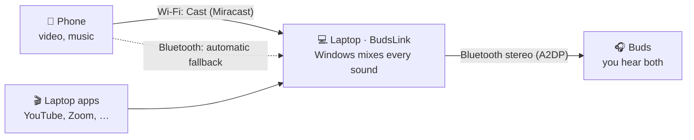

# BudsLink

**Hear your laptop and your phone in the same Bluetooth earbuds at the same time, even buds without multipoint. Nothing to install on the phone. Free and open source.**

BudsLink is a small Windows 11 tray app. Your buds stay connected to the laptop; your phone's sound reaches the laptop over Wi-Fi (the phone's built-in *Cast*) or over Bluetooth, and Windows mixes it with the laptop's own sound into the buds. A video on the laptop and a video on the phone: you hear both.

> **Status: preview.** Everything below is built and unit-tested (Rust and UI).
> Real-hardware results are tracked in [docs/HARDWARE_TESTING.md](docs/HARDWARE_TESTING.md);
> until that checklist is filled in for a setup, treat it as untested there.

## How it works

Earbuds without multipoint can hold only one connection. So BudsLink keeps that one connection on the laptop and brings the phone's sound to the laptop instead.



1. **The buds stay on the laptop.** BudsLink connects them, reconnects them after a drop, and makes them the laptop's default output. When they go away, your previous output comes back.
2. **The phone sends its sound to the laptop**, one of two ways, with nothing installed on the phone:
   - **Wi-Fi:** BudsLink contains a Miracast receiver (`Windows.Media.Miracast`). It shows up as **BudsLink** in the phone's Cast list, like a TV. Tap it once.
   - **Bluetooth:** the laptop acts as a Bluetooth speaker for the paired phone (`AudioPlaybackConnection`), and BudsLink opens that link itself. Nothing to tap.
3. **Windows mixes everything into the buds:** the phone plus every app on the laptop, each with its own volume slider in BudsLink.

### Which way the phone connects

| Setting | While the phone casts | Otherwise |
|---|---|---|
| **Auto** (default) | Wi-Fi | Bluetooth |
| **Wi-Fi only** | Wi-Fi | — |
| **Bluetooth only** | — | Bluetooth |

The same phone never plays twice, so there is no echo: while it casts, the Bluetooth link is held off, and about 3 s after the cast ends it comes back.

Android does not let another device pull sound out of a phone over Wi-Fi by itself, so the Wi-Fi way always needs one tap on **Cast**. The Bluetooth way needs none.

## Features

- **Tray dock**: live picture of phone → laptop → buds, "N sources in your buds", tiles for buds and phone, a Sources list, Test beep.
- **Sources with their own volume**: Buds (master), Laptop, Phone over Wi-Fi, Phone over Bluetooth, each with status (Waiting, Connecting, Playing, Reconnecting, Paused, Error), a slider and mute.
- **Phone approvals**: a new phone that casts is asked about once (Allow always / Just this time / Refuse); allowed phones are remembered and can be forgotten.
- **Phone screen window**: a small window shows the cast; hide it anytime, the sound keeps playing.
- **Setup check** on first start: Bluetooth on, buds and phone paired, network Private, firewall rule (Private networks only), Wi-Fi card Miracast support, the optional Wireless Display fallback, and "Do you hear the beep?". Each problem has a Fix button; fixes that need admin rights ask Windows once.
- **Call-mode warning**: if an app opens the buds' microphone, Windows drops them to hands-free (HFP) quality; BudsLink says so. BudsLink itself never opens the microphone.
- **It just works**: starts with Windows in the tray, auto-reconnects buds (1 s … 30 s), retries the phone (5 s … 60 s) and the receiver, notices sleep/wake, follows default-output changes, shows "Phone audio is now in your buds".
- **Diagnostics**: Copy diagnostics (Windows build, Bluetooth, networks and their profile, firewall, Miracast support, audio endpoints, receiver state). Logs in `%LOCALAPPDATA%\io.github.mrehankamboh.budslink\logs`.
- **Demo mode** (`BUDSLINK_DEMO=1`): fictional buds and phones, including a phone that starts casting, to try the UI without hardware.
- **Private**: no account, no telemetry, nothing sent to the internet. The receiver runs on Private networks only.

## Requirements

- Windows 11 (Windows 10 2004+ may work, untested), Bluetooth.
- For Wi-Fi: a Wi-Fi card that can receive Miracast (`netsh wlan show wirelesscapabilities` → `Miracast Sink : Supported`) and an Android phone with Cast / Screen cast / Smart View.
- For Bluetooth: the phone paired with the laptop once.

## Connect your phone

Step by step for the Infinix Hot 11 Play (XOS) and other Android phones: [docs/CONNECT_PHONE.md](docs/CONNECT_PHONE.md). The app has the same guide under **How to connect my phone**.

## Build it yourself (beginner steps)

1. Install **Visual Studio 2022 Build Tools** with *Desktop development with C++* (free):
   ```powershell
   winget install --id Microsoft.VisualStudio.2022.BuildTools --override "--passive --wait --add Microsoft.VisualStudio.Workload.VCTools --includeRecommended"
   ```
2. Install **Rust**: `winget install --id Rustlang.Rustup`, then open a new terminal.
3. Install **Node.js 22+** (nodejs.org) and **pnpm**: `npm install -g pnpm`.
4. Build:
   ```powershell
   git clone https://github.com/Mrehankamboh/BudsLink.git
   cd BudsLink\apps\desktop
   pnpm install
   pnpm tauri dev      # run it
   pnpm tauri build    # target\release\budslink.exe and the per-user NSIS installer
   ```

More commands (tests, demo mode, the hardware probes): [docs/DEVELOPMENT.md](docs/DEVELOPMENT.md).

## Troubleshooting

| Problem | What to do |
|---|---|
| "Network is Public" | Setup check → **Make Private (admin)**, only on your home Wi-Fi |
| The phone doesn't list BudsLink | Keep Wi-Fi on on both; Cast → ⋮ → Enable wireless display; run the setup check; or use Bluetooth |
| "This laptop's Wi-Fi card cannot receive Miracast" | The phone uses Bluetooth instead (Auto does this by itself) |
| "Firewall rule for BudsLink missing" | Setup check → **Allow (admin)** (Private networks only) |
| "Buds switched to call mode (HFP)" | An app uses the buds' mic: end the call or pick another microphone |
| "Phone not paired" | Windows Settings → Bluetooth & devices → Add device |
| Phone paired but "Windows won't take its audio" | Remove the phone in Bluetooth settings and pair again from the laptop |

Then **Copy diagnostics** and include it in an issue.

## Known limitations (honest notes)

- **Latency**: Miracast adds about 100–300 ms and Bluetooth to the buds another 150–250 ms, so video watched on the phone's own screen is slightly out of lip-sync. Phone audio over Bluetooth is about 0.2–0.4 s late.
- **The phone must tap Cast** for the Wi-Fi path; Android allows nothing else without an app.
- **Some Wi-Fi cards cannot receive Miracast**; then the phone uses Bluetooth.
- **DRM apps** (e.g. Netflix) may block casting.
- **Public Wi-Fi is not supported** for the receiver, on purpose.
- **Phone sounds**: while casting, Android sends media to the laptop; ringtones and notifications may still play on the phone.
- **One radio**: buds and a Bluetooth phone share the laptop's Bluetooth radio, which can stutter on some laptops. The Wi-Fi path leaves Bluetooth to the buds.
- **The default output is switched with `IPolicyConfig`**, an undocumented Windows interface also used by the Sound control panel and EarTrumpet. If a Windows update breaks it, BudsLink shows the error. The "communications" default is left alone so call apps don't drop the buds to HFP.
- **Laptop volume slider** scales other apps' own levels and gives them back on quit; Windows' own volume mixer still works alongside it.
- **Unsigned build**: Windows SmartScreen warns once (More info → Run anyway). Smart App Control blocks unsigned apps.
- **iPhone over Wi-Fi (AirPlay)** is not included yet (optional milestone M6). iPhones can use the Bluetooth path.

## Project layout

```
crates/
  budslink-core/       state machines and policies (no OS code): buds, Bluetooth phone,
                       cast + approvals, Auto Wi-Fi/Bluetooth router, laptop-audio routing,
                       per-source volume, settings, demo backends
  budslink-win/        Windows: Bluetooth endpoints, connect/disconnect, phone audio,
                       default output, call-mode check, test tone, volumes, setup checks
  budslink-miracast/   Miracast receiver, Private-network check, phone screen window;
                       examples/cast-probe.rs
apps/desktop/          Tauri 2 app: tray, dock, settings, setup check (React UI in src/)
scripts/               fix-prereqs.ps1 (the one-time admin fixes)
docs/                  development, hardware testing, connecting the phone
```

## License

MIT. See [LICENSE](LICENSE) and, for the open-source parts BudsLink uses, [THIRD_PARTY_NOTICES.md](THIRD_PARTY_NOTICES.md).
